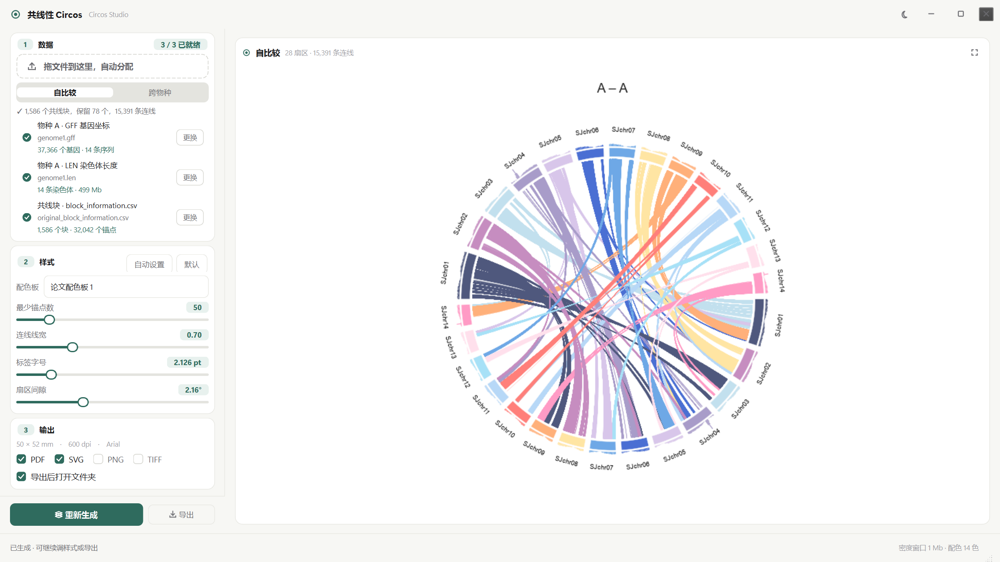
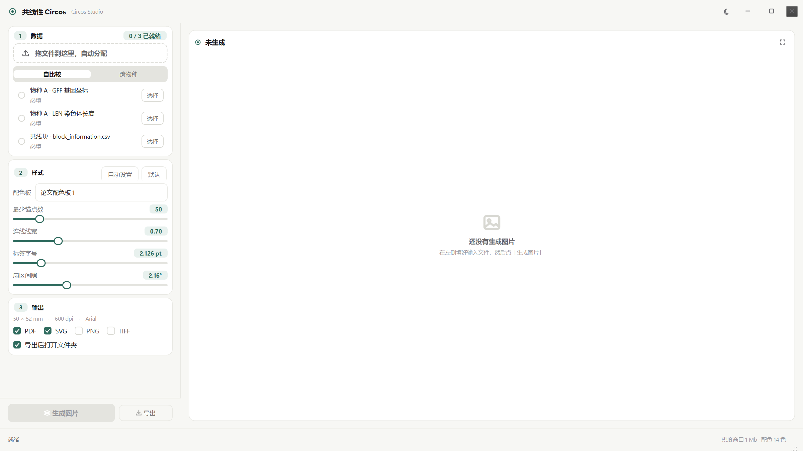
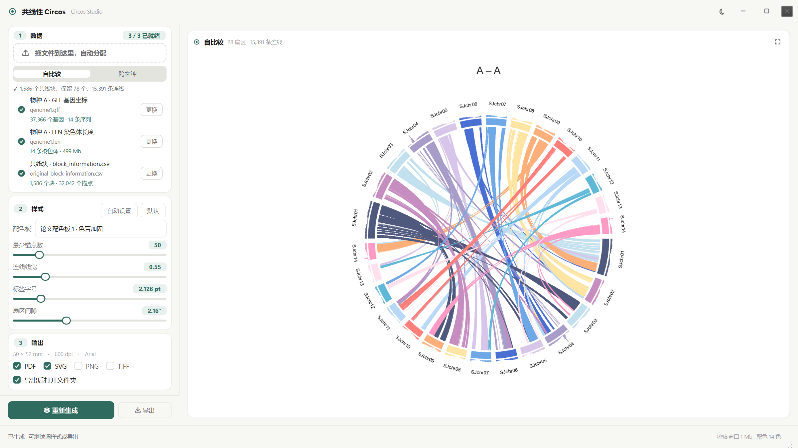

# Circos Studio

用 WGDI 共线性结果画 Circos 图的 Windows 桌面程序。纯 Python，不依赖 Perl / conda。

**开发完成**：M0–M5 全部走完，五项自动检查全绿，打包好的 `dist\CircosStudio.exe` 在清空环境变量的临时目录里验证通过。



## 三种用法

| 场景 | 怎么做 |
|---|---|
| 普通用户 | 双击 `dist\CircosStudio.exe`（免安装，首次启动约 6 秒，有启动闪屏） |
| 开发调试 | `run-debug.cmd`（带控制台），或 `python -m app` |
| 命令行批处理 | `tools\render_cli.py`，见下 |

## 界面流程

1. 拖入或选择三个文件：物种 A 的 `.gff` / `.len`、`block_information.csv`
   - 自比较只要 3 个；切到「跨物种」自动展开物种 B 的两个槽位，共 5 个
2. 每个槽位即时显示解析结果（如「37,366 个基因 · 14 条序列」），全绿才允许生成
3. 点「生成图片」→ 后台渲染，出图后改任何样式参数都会**自动刷新预览**
4. 「导出」勾选格式 → 选文件夹 → 600 dpi 写出，可选自动打开文件夹



## 样式

- **自动设置**：按扇区数和连线数定标签字号、扇区间隙、线宽
- **默认**：论文默认值（50×52 mm、0.7 线宽、2.126 pt 标签、2.16° 间隙、paper1）
- **配色板**：12 套，含「论文配色板 1 · 色盲加固」（只改 1 个颜色）



## 验证

本仓库只放程序本体；验证脚本依赖作者的本地数据集，因此没有随仓库发布。
开发期全部通过的结果如下（`python -m app --selftest` 可随时复验渲染链路）：

| 检查 | 判据 | 结果 |
|---|---|---|
| 数据层单测 | 18 项边界用例 | ✅ 18 / 0 |
| 六套真实数据 | 扇区 / 保留块 / 连线数与已发表数字一致 | ✅ 全部一致 |
| 渲染对照 | 与 Circos 成品图几何 ±2.5 px、墨量 ±4 | ✅ 圆心 ±0.5 px，墨量 41.66 vs 41.68 |
| 导出格式 | PDF/SVG 141.73×147.49 pt；PNG/TIFF 1181×1229 RGB LZW | ✅ 四种通过 |
| 预处理回归 | 06 数据集 gff/len/蛋白与既有产物逐行比对 | ✅ 37,366 行零差异 |
| WGDI 流水线 | `-icl` / `-bi` 块数与既有结果一致 | ✅ 1222 / 1222 |
| 超大基因组 | 百合 `.fai`（43 亿 bp 单条染色体） | ✅ 越过 2³¹ 偏移读取正确 |
| 窗口 | 1600×900、面板免滚动、标题栏命中 HTCLIENT | ✅ 八项通过 |
| 打包产物 | 清空 PYTHONPATH 后自检 + 截图 | ✅ 退出码 0 |

## 打包

```bat
build\build.cmd
```

产出 `dist\CircosStudio.exe`（约 73 MB，one-file）。规格文件 `build\circos_studio.spec`。

## 命令行出图

```bat
python tools\render_cli.py --gff1 Sjap.gff --len1 Sjap.len ^
    --blocks Sjap-Sjap_block_information.csv --layout self --out out.pdf --auto
```

`--palette` 换配色板，`--auto` 按数据规模自动定样式。

## 目录

```
circos_studio/
├─ app/
│  ├─ __main__.py        入口、命令行、--screenshot / --selftest
│  ├─ core/              纯 Python，无 Qt 依赖
│  │  ├─ model.py        Gene / Chromosome / Genome / Block / Dataset
│  │  ├─ wgdi.py         三个输入文件的解析 + 快速探测
│  │  ├─ density.py      基因密度分窗
│  │  ├─ layout.py       扇区角度、极坐标、贝塞尔控制点、标签旋转
│  │  ├─ style.py        样式参数 + 默认 / 自动预设
│  │  └─ palette.py      12 套配色板
│  ├─ render/
│  │  ├─ figure.py       唯一绘制入口（matplotlib Figure）
│  │  └─ export.py       PDF / SVG / PNG / TIFF
│  ├─ ui/
│  │  ├─ theme.py        颜色 token + QSS（浅色/深色）
│  │  ├─ icons.py        手绘线条图标
│  │  ├─ widgets.py      Card / Segmented / SliderRow / DropZone / SlotRow / Check
│  │  ├─ worker.py       QThread 渲染与导出
│  │  └─ main_window.py  标题栏、输入面板、画布、状态栏
│  └─ resources/         启动闪屏
├─ build/                PyInstaller spec + build.cmd
├─ dist/CircosStudio.exe
├─ docs/                 交付截图
├─ tests/, tools/
├─ main.py               冻结入口
└─ run.cmd / run-debug.cmd
```

## 窗口

- 默认 1600×900（16:9），窗口尺寸/主题/上次打开与导出目录会记住
- 无边框窗口：拖动标题栏交给 Windows 原生 `startSystemMove`（支持贴边分屏），
  八向缩放用 `WM_NCHITTEST` 实现，双击标题栏最大化
- 命中测试全程用**物理像素**（`GetWindowRect` + 窗口 DPI 比例）。混用逻辑坐标会在
  150% 缩放下把右侧半个窗口误判成缩放边缘，导致标题栏按钮全部失效——`check_window.py`
  和 `--selftest-ui` 都是为这个问题加的回归保护

## 已知限制

- 只在 Windows 11 上验证过
- one-file 版冷启动约 6 秒（解包 73 MB）；要更快可改成 one-dir
- 一次一张图；多图并排比较需要分别导出后自行拼版
